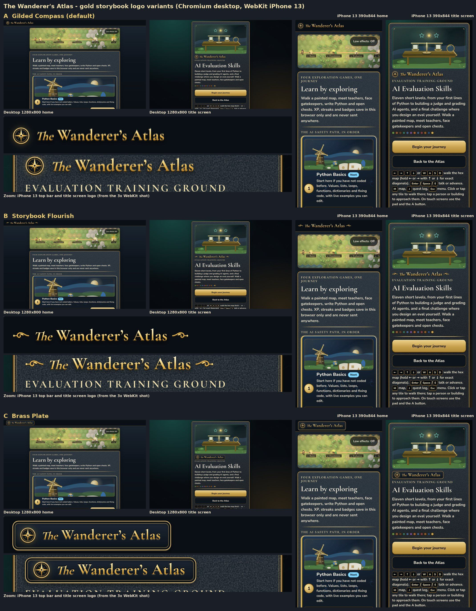

# The Wanderer's Atlas: gold storybook logo (draft for review)

One wordmark, three looks. All use free assets only: Cormorant Garamond (Google Fonts, already loaded by every page), CSS gradients and shadows, and an inline SVG compass rose. The words stay real text, so screen readers read "The Wanderer's Atlas".

| Variant | Class | Look |
|---|---|---|
| **A. Gilded Compass** (default in this PR) | `logo-a` | Small gold compass rose, then the name in an embossed gold gradient. No frame. |
| B. Storybook Flourish | `logo-b` | No compass. Brighter gold name between two curly leaf swashes, like a storybook title page. |
| C. Brass Plate | `logo-c` | Compass and name set inside a dark engraved plaque with a double gold border. |

Where it appears: the home page top bar and the top of each world's title screen (above the world kicker).

Checks (Chromium and WebKit, desktop 1280x800 and iPhone 13 390x844): one line in every case, widest is B at 258px on a 390px phone; no console errors.

To switch variant, change `logo-a` to `logo-b` or `logo-c` in `index.html` (top bar) and `shared/world.js` (title screen).
